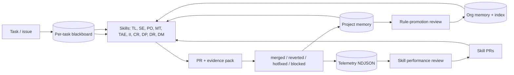

# agent-skills

Reusable [Agent Skills](https://agentskills.io/) for software-engineering work — portable,
role-shaped workflows your AI assistant can load on demand so the same model produces
senior-engineer, product-owner, tester, or reviewer output instead of generic answers.

> **Status:** `0.44.0` — pre-1.0, private. Core skill set is shipped and stable for internal use;
> interfaces may still evolve. v0.43.x froze the installation and distribution contract ahead of
> `1.0.0-rc.1`; v0.44.0 adds the Engineering Tool Capability Framework — the last substantial
> feature release before `1.0.0-rc.1` — and removes the project's former open-source licensing.

## Start here

```bash
npx @wamalalawrence/agent-skills install
```

Then open any repository on your machine and ask:

```text
Use Wamala to investigate this project.
```

That is the whole setup. No clone, no per-repository step, no credentials.

| I want to… | Go to |
| --- | --- |
| See it work in five minutes | [Quickstart](docs/quickstart.md) |
| Know what to type | [Starter prompts](docs/starter-prompts.md) · [Examples](docs/examples/README.md) |
| Pick the right skill | [Skills](#skills) |
| Install, update, or roll back | [Install](#install) · [docs/installation.md](docs/installation.md) |
| Understand what it will not do | [Known limitations](docs/known-limitations.md) |
| Read everything | [docs/README.md](docs/README.md) |

## Contents

- [Start here](#start-here) — install and first prompt
- [Wamala](#wamala) — the front door
- [Why skills](#why-skills) — what a skill changes
- [Install](#install) — install, update, roll back, uninstall
- [Skills](#skills) — the eleven skills, and which one owns what
- [The company brain](#the-company-brain) — memory, knowledge, telemetry
- [Documentation](#documentation) — the full index
- [Design principles](#design-principles) · [Contributing](#contributing) · [License](#license)

## Wamala

Wamala is the front door to Agent Skills.

Tell Wamala what needs to be done. It classifies the work, determines which specialist owns the
next step, dispatches fresh-context agents, and keeps multi-step delivery aligned through
persisted artifacts.

```text
Use Wamala to investigate why invoice search loses its filter on page 2.
```

```text
Use Wamala to take this feature from requirement to delivery.
```

Wamala coordinates; the specialists do the work, and they keep their role-based names —
[`software-engineer`][software-engineer], [`product-owner`][product-owner],
[`manual-tester`][manual-tester], and the rest. Invoking any of them directly stays first-class
and is faster whenever you already know the owner.

## Why Skills

A general-purpose LLM is a general practitioner: capable, broad, but not specialized. A skill turns
that same model into a specialist for a narrow, high-value task — with the right context, the right
checklist, and the right stopping conditions.

- **Without a skill:** you ask "fix this bug" and hope the model remembers your standards.
- **With a skill:** the model follows a tested workflow — gather just enough evidence, propose a
  safe plan, implement, self-review, and stop when context is missing instead of guessing.

## Install

Install once, per machine. Use from any local project. Configure external access only when needed.

```bash
npx @wamalalawrence/agent-skills install
```

**Everyday commands** — the durable command is `agent-skills`; npm is not needed again.

| Command | Does |
| --- | --- |
| `agent-skills doctor` | What this environment can actually do |
| `agent-skills verify` | Check the installation, write nothing |
| `agent-skills update` | Move to the latest release, transactionally |
| `agent-skills rollback` | Return to the release you were on before |
| `agent-skills versions` | What is installed, active, and available |
| `agent-skills hosts` | Which editors and agents see the skills |
| `agent-skills uninstall` | Remove it, keeping everything you own |

Requirements: Python 3.8+, bash, and git. macOS or Linux; on Windows use WSL or Git Bash.

**What installing actually does.** It puts `agent-skills` on the **machine**, registers the skills
with every supported agent host it finds, and makes the runtime invocable from anywhere:

```text
  resolve    0.44.0 (stable, via git)
  download   164 files staged
  verify     payload hash and version agree
  self-test  staged runtime answers correctly
  activate   current -> versions/0.44.0
  hosts      claude-code, agents-standard, cursor, codex
  verified   installation is consistent

Agent Skills 0.44.0 is installed.

  install root : ~/.agent-skills
  active release: ~/.agent-skills/versions/0.44.0
  hosts        : claude-code, agents-standard, cursor, codex
  command      : ~/.local/bin/agent-skills

No credentials were requested or stored.
```

Nothing is activated until the release has been downloaded, checked against the hash it was
published with, and run once off to the side. If any of that fails, the version you already had is
still the version you are running — and `agent-skills rollback` undoes an update you regret.

The npm package is a bootstrap and nothing more: it fetches and verifies a release, then hands over
to the installer. The product itself is never inside it.

Then open any repository on the machine — one you already have, or one you clone next year — and
invoke a skill. There is no per-workspace setup step and no sibling `agent-skills` checkout.

### Execution Guard (opt-in)

Skills carry a [destructive-action safety policy](docs/destructive-action-safety.md). That policy
works on the agent's reasoning, which means it holds while the agent is reasoning correctly.
[Execution Guard](docs/execution-guard.md) is the second layer: a deterministic check that runs
**before** every shell command and tool call and answers allow, ask, or deny.

```bash
agent-skills guard install --dry-run   # exactly what would change, nothing written
agent-skills guard install             # register the pre-execution hooks
agent-skills guard doctor              # which of your hosts actually enforce
```

It is not installed automatically, because it edits the host configuration files that decide what
your agent may do, and that is not a good place for a surprise. Installation preserves every hook
you already had, is idempotent, and `agent-skills guard uninstall` removes only its own entries.

```text
Execution Guard

  Claude Code                    ENFORCED     PreToolUse hook
  Cursor                         ENFORCED     beforeShellExecution + beforeMCPExecution
  Kiro                           ENFORCED     preToolUse hook
  Codex                          ENFORCED     PreToolUse hook
  GitHub Copilot / VS Code       PARTIAL      terminal auto-approval rules
  JetBrains AI / Junie           ADVISORY     Action Allowlist
```

`rm -rf ./build` is allowed, `git push origin main` asks, and `rm -rf /` is denied — including
when it arrives as `true && rm -rf /`, `$(rm -rf /)`, or `bash -c 'rm -rf /'`, and including when
a hostile file in the repository is what talked the agent into it. `echo "rm -rf /"` is allowed,
because the guard parses the command rather than matching its text.

Repository configuration can make the guard stricter and can never make it weaker. Neither layer
makes the machine safe; [what it cannot do](docs/execution-guard.md#known-limitations) is part of
the documentation, not a footnote.

Setup asks for **no** credentials: no Jira, Confluence, Sonar, GitHub, database, or API token, and
no list of projects you might work on. When a task actually needs an external service,
`agent-skills` resolves access on demand — preferring an already-authenticated tool or session,
then project configuration, then a reusable user-level identity. See
[docs/access-resolution.md](docs/access-resolution.md).

Everything after the install is one command:

```bash
agent-skills doctor     # what can this environment actually do?
agent-skills verify     # is the installation healthy?
agent-skills hosts      # which agents see the skills, and where from
agent-skills update     # apply a new release
```

Full details, flags, and the supported-host table: [docs/installation.md](docs/installation.md).

### Cloud and remote agents

A cloud agent cannot read files on your laptop, so the global install does not reach it. Those
environments use an **in-repo** mechanism instead — commit `.agent-skills.yml` and vendor or
reference the skills inside the target repository. That covers GitHub Copilot coding agent, Cursor
cloud/background agents, Codespaces, Gitpod, Devin, and web chats with a repo attached. See
[docs/execution-modes.md](docs/execution-modes.md).

### Upgrading from an earlier release

Run the installer. It recognises an existing installation, moves it onto the versioned layout, and
keeps your credential identities, project bindings, and unrelated skills exactly where they are.

```bash
npx @wamalalawrence/agent-skills install
```

If you are coming from the pre-v0.37 workspace layout — a `.env`, `.jira-config.yml`, and `.skills`
symlink beside a clone — none of it is deleted, and the access resolver still reads that `.env` for
you. `agent-skills migrate` reports what is now obsolete and what is still in use. The old clone
itself is no longer needed and can be removed once you have installed.

### Or — install individual skills via the [Agent Skills](https://skills.sh) ecosystem

```bash
npx skills add wamalalawrence/agent-skills
```

That is skill-level interoperability, not a complete installation. It copies `SKILL.md` files; it
does not install the runtime those skills call — the access resolver, Context Optimizer, Execution
Guard, memory, and the lifecycle helpers. Use it to try a single skill inside another toolchain. Use
the first-party CLI to install the product.

## Updating

```bash
agent-skills check-updates   # read-only; exit 0 up to date, 10 update available
agent-skills update          # download, verify, activate — transactionally
agent-skills rollback        # return to the release you were on before
```

An update is staged and verified in full before anything on the machine changes, so a failed one
leaves the previous release running rather than a half-installed mixture. The previous release is
kept, and `rollback` restores it along with every host registration and security hook that pointed
at it.

`agent-skills update` never runs on its own, never pushes anything, and never silently replaces a
newer release with an older one — going backwards is `rollback`, and it is always something you
asked for.

Releases are git tags (`v0.42.0`, `v0.43.0`, …). Where a release comes from is a choice the
installer makes through a release provider, not something wired into it; see
[docs/release-providers.md](docs/release-providers.md).

## Skills

Unsure which one you need? You do not have to choose. Invoke [`wamala`][wamala], describe the work,
and it picks the owner. Naming a skill directly stays first-class and is faster when you already
know the answer.

| Skill | Owns | Reach for it when |
| --- | --- | --- |
| [`wamala`][wamala] | Routing | You do not know which specialist should act next |
| [`product-owner`][product-owner] | Requirements | A request is vague, and building it now would be guessing |
| [`delivery-planner`][delivery-planner] | Planning | Work spans several repos, teams, or phases |
| [`delivery-runner`][delivery-runner] | Execution | A plan exists and someone has to drive it to done |
| [`software-engineer`][software-engineer] | Code | Something needs building, fixing, or changing |
| [`issue-investigator`][issue-investigator] | Diagnosis | A bug needs evidence and a root cause, not a guess |
| [`code-reviewer`][code-reviewer] | Review | A diff needs judging against the task it claims to do |
| [`manual-tester`][manual-tester] | Exploratory testing | You need to know how it actually behaves |
| [`test-automation-engineer`][tae] | Automated tests | Coverage needs to hold the behaviour down |
| [`domain-modeler`][domain-modeler] | Domain language | The code and the business disagree about words |
| [`context-optimizer`][context-optimizer] | Large inputs | The file is far too big for any model to read |

**Nine top-level skills** are meant to be invoked directly. **Two nested support skills** —
`issue-investigator` and `code-reviewer` — are loaded by the engineering workflow when it needs a
more specific checklist.

Each is described in full below.

### [`wamala`][wamala] (top-level)

- Key collaborators: every skill below — it dispatches to them and implements nothing itself.
- Purpose: the **front door**. Classifies any request, runs the requirement-understanding gate,
  picks the one skill that owns the next step, and dispatches a **fresh empty-context agent** to
  do it. Drives multi-specialist chains (refine, implement, test), verifying each step from
  persisted artifacts before advancing. Dispatches; never implements, reviews, refines, or tests,
  so the depth-cap review bound stays intact.
- Sample command:

  ```text
  Use Wamala to investigate why invoice search drops the status filter on page 2.
  ```

`issue-investigator` and `code-reviewer` are currently nested under `software-engineer` because they
support the engineering implementation loop. They may become top-level skills later only if real
usage shows they are useful independently.

### [`delivery-planner`][delivery-planner] (top-level)

- Key collaborators: `software-engineer`, `product-owner`, `issue-investigator`, `manual-tester`,
  `test-automation-engineer`.
- Purpose: turn a single large or multi-day task into a one-page **destination brief** plus a
  sequence of small, self-contained **execution phases**. Each phase is sized so a fresh agent
  loaded with `destination.md` + one `phase-NN.md` has enough — and only enough — context to
  execute it well. Decomposes work; does not execute it.

### [`delivery-runner`][delivery-runner] (top-level)

- Key collaborators: `delivery-planner`, `software-engineer`, `issue-investigator`,
  `product-owner`, `manual-tester`, `test-automation-engineer`.
- Purpose: execute a `delivery-planner` plan end-to-end with no manual handoff —
  it reads the plan index's dispatch pointer, opens a **fresh empty-context
  agent for each phase** (just like re-opening a new chat), waits, verifies the
  result from the persisted plan artifacts (never from chat), then advances
  until the plan is done, blocked, or needs a human. Dispatches fresh agents; it
  does not implement phases itself, so the depth-cap review bound stays intact.
- Sample command:

  ```text
  Use the delivery-runner skill to execute the PROJ-1234 plan end-to-end.
  Dispatch each phase as a fresh sub-agent and stop if anything blocks.
  ```

### [`software-engineer`][software-engineer] (top-level)

- Key collaborators: `product-owner`, `manual-tester`, `test-automation-engineer`,
  `delivery-planner`.
- Purpose: end-to-end engineering — context discovery, implementation, the developer tests that
  ship with the change, QA, self-review, PR preparation.

### [`product-owner`][product-owner] (top-level)

- Key collaborators: `software-engineer`, `manual-tester`, `test-automation-engineer`.
- Purpose: clarifies goals, requirements, scope, acceptance criteria, UX concerns,
  and handoff notes.

### [`manual-tester`][manual-tester] (top-level)

- Key collaborators: `product-owner`, `software-engineer`, `test-automation-engineer`.
- Purpose: plans and executes manual validation, exploratory testing, defect
  reporting, and retest guidance.

### [`test-automation-engineer`][tae] (top-level)

- Key collaborators: `software-engineer`, `manual-tester`, `product-owner`,
  `issue-investigator`.
- Purpose: the whole automation job. Writes new coverage at the right level, maintains
  existing suites through product change, triages CI failures into product defects versus
  automation problems, diagnoses flakes instead of retrying them, decides what to automate
  and what to keep manual, and keeps requirement-to-test traceability. Framework aware,
  framework independent — it follows the repository's own stack.

### [`domain-modeler`][domain-modeler] (top-level)

- Key collaborators: `product-owner`, `software-engineer`, `delivery-planner`.
- Purpose: maintains canonical domain terminology and records ADRs only when the
  decision is hard to reverse and worth preserving.

### [`context-optimizer`][context-optimizer] (top-level)

- Key collaborators: `issue-investigator`, `software-engineer`, `code-reviewer`,
  `test-automation-engineer`.
- Purpose: the input itself is too big to read — a multi-million-line log, an 800-table schema
  dump, a generated specification, a 40,000-line diff, a CI log where one compile error caused
  four hundred later failures. Inspects it cheaply and locally first (no model sees the whole
  file), then extracts only the evidence the current question needs. Every fragment carries
  provenance, every omission is reported, and the character budget is honoured exactly.
- The runtime behind it is available to **every** skill as `agent-skills context pack`, so no
  skill dispatches an agent merely to shrink a file.
- Sample command:

  ```text
  Use Context Optimizer to extract what matters from this production log for the
  payment failure on transaction 84721.
  ```

### [`issue-investigator`][issue-investigator] (nested support)

- Key collaborators: `software-engineer`, `manual-tester`, `product-owner`.
- Purpose: builds issue evidence, reproduction steps, root-cause status, and
  handoff.

### [`code-reviewer`][code-reviewer] (nested support)

- Key collaborators: `software-engineer`, `test-automation-engineer`,
  `issue-investigator`.
- Purpose: reviews diffs against issue context, evidence packs, quality risks, test quality, and
  definition of done.

[wamala]: skills/wamala/
[delivery-planner]: skills/delivery-planner/
[delivery-runner]: skills/delivery-runner/
[software-engineer]: skills/software-engineer/
[product-owner]: skills/product-owner/
[manual-tester]: skills/manual-tester/
[tae]: skills/test-automation-engineer/
[domain-modeler]: skills/domain-modeler/
[context-optimizer]: skills/context-optimizer/
[issue-investigator]: skills/software-engineer/skills/issue-investigator/
[code-reviewer]: skills/software-engineer/skills/code-reviewer/

## The Company Brain

`agent-skills` is built so the eleven specialist skills compound value across
projects, sessions, and time — not just one task. Every task writes to a
shared blackboard, every PR's outcome is recorded, every recurring lesson can
be promoted into org-tier memory, and a telemetry layer records what actually ran
so "the skills are improving" can become a number rather than a feeling. The loop:



See [`docs/company-brain.md`](docs/company-brain.md) for the full contract and
the per-tier docs: [task blackboard](docs/task-blackboard.md),
[project memory](docs/project-memory.md), [org memory](docs/org-memory.md),
[telemetry](docs/telemetry.md).

## Documentation

- [Docs index](docs/README.md)
- [First-time user quickstart](docs/quickstart.md)
- [Installation](docs/installation.md)
- [Release providers and distribution](docs/release-providers.md)
- [Configuration](docs/configuration.md) — project configuration, which never holds a secret
- [Access resolution](docs/access-resolution.md) — the one generic mechanism for reaching any
  external service: the deterministic precedence order, credential identities, OS-native secret
  storage, and the rule that a committed file can never select an identity
- [Issue tracker / Document store auth discovery](docs/auth-discovery.md) — the service-specific
  Jira/Confluence walk, kept as an example on top of the generic resolver
- [GitHub access ladder](docs/github-access.md) — `gh auth status` → account switching →
  HTTPS → SSH; the ladder an agent must walk before declaring "no GitHub access"
- [Execution Guard](docs/execution-guard.md) — the runtime layer under the destructive-action
  policy: a deterministic pre-execution check that classifies every shell command and tool call
  as allow, ask, or deny. The decision model, the hard-deny floor, why the command is parsed
  rather than pattern-matched, symlink and workspace resolution, the trust levels that stop
  repository text weakening it, per-host enforcement, redacted auditing, and its limits
- [MCP](docs/mcp.md) — this repository ships and enables no MCP servers; what it does define is
  the tool-preference order every skill follows, a recommended minimal set, and why the real
  argument for MCP here is OAuth instead of stored tokens
- [Repo knowledge](docs/repo-knowledge.md) — the committed, PR-reviewed knowledge base that
  lives **inside the repository being worked on**, so what one agent learns survives a fresh
  clone, a CI runner, and a teammate; confidence-scored lessons with budgeted, ranked recall
- [Lifecycle preflight](docs/lifecycle-preflight.md) — the full contract behind the two
  commands every skill runs, including the capability report and the statuses that preserve
  scratch for a resuming agent
- [Project memory](docs/project-memory.md) — the per-project knowledge file every skill
  reads on start and updates after every successful task; preserved through per-task cleanup
- [Company Brain](docs/company-brain.md) — the self-improving loop that ties
  the three memory tiers, blackboard, outcome feedback, telemetry, rule
  promotion, and the eval harness together
- [Org memory](docs/org-memory.md) — cross-project tier above per-project
  memory, plus the project ↔ shared-library index
- [Task blackboard](docs/task-blackboard.md) — per-task shared working memory
  every skill reads and writes during a task
- [Telemetry](docs/telemetry.md) — append-only event log per project
- [Skill-source resolution](docs/skill-source-resolution.md) — which skill directory the
  agent must use when more than one is present on disk
- [Updates](docs/updates.md) — how to notice and apply new agent-skills releases
- [Using with your AI assistant](docs/assistants.md)
- [Starter prompts](docs/starter-prompts.md)
- [Examples](docs/examples/README.md)
- [Validation](docs/validation.md)
- [Skill quality scorecard](docs/skill-quality-scorecard.md)
- [Writing voice](docs/writing-voice.md) — everything a skill writes for a human reader
  (code comments, commits, PR text, tracker comments, doc pages) should read as though a
  careful colleague wrote it; the banned AI tells, and the honesty boundary those rules
  must never cross
- [Insightful simplifications](docs/insightful-simplifications.md) — optional bounded
  framing section skills MAY emit when one short architectural observation would help the
  user see the wider shape of the problem
- [Requirement-understanding workflow](docs/requirement-understanding.md) — the gate every
  relevant skill runs before implementation, review, testing, or automation
- [Requirement-understanding scorecard](docs/requirement-understanding-scorecard.md)
- [Skill performance review](docs/skill-performance-review.md)
- [Eval runs](eval-runs/README.md)
- [Release checklist](docs/release-checklist.md)
- [Skill boundaries](docs/skill-boundaries.md)
- [Severity and confidence definitions](docs/severity-and-confidence.md)
- [Known limitations](docs/known-limitations.md)
- [Versioning policy](docs/versioning.md)
- [Destructive-action safety policy](docs/destructive-action-safety.md) — what every skill
  must refuse to do, and why
- [Roadmap](ROADMAP.md) · [Support](SUPPORT.md) · [Governance](GOVERNANCE.md) ·
  [Security](SECURITY.md) · [Changelog](CHANGELOG.md)

## Design Principles

- **Portable:** no company names, hostnames, tokens, repository names, or local paths inside skill
  files.
- **Context-aware:** skills use issue context, linked docs, repository conventions, tests, and CI
  signals before recommending changes.
- **Token-conscious:** gather the smallest useful evidence pack first, then expand only when
  ambiguous or high risk.
- **Collaborative:** implementation, review, and issue resolution are one engineering loop;
  `software-engineer` auto-iterates with `code-reviewer` until convergence or bounded escalation.
- **Layered:** prompt-level policy states the contract; [Execution Guard](docs/execution-guard.md)
  enforces the part of it a runtime can check, deterministically, at the moment of execution.
  Neither layer is claimed to be sufficient on its own.
- **Maintainer-realistic:** governance, support, and roadmap promises match a solo-maintainer
  private project.

## Contributing

This is a private, solo-maintained project built for the maintainer's own engineering work. It is
not open to outside contribution and is not distributed for outside use. The internal bar for a
change is in [CONTRIBUTING.md](CONTRIBUTING.md).

## License

Proprietary. Copyright (c) 2026 Lawrence Wamala. All rights reserved. No license to use, copy,
modify, or distribute is granted — see [LICENSE](LICENSE).
