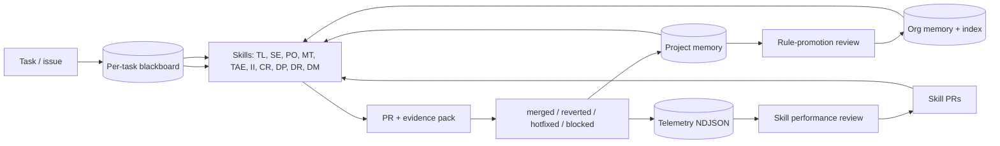

# agent-skills

Reusable [Agent Skills](https://agentskills.io/) for software-engineering work — portable,
role-shaped workflows your AI assistant can load on demand so the same model produces
senior-engineer, product-owner, tester, or reviewer output instead of generic answers.

> **Status:** `0.37.0` — pre-1.0. Core skill set is shipped and stable enough for public use;
> interfaces may still evolve.

New here? Start with the [quickstart](docs/quickstart.md), then read [starter
prompts](docs/starter-prompts.md), [examples](docs/examples/README.md), the
[requirement-understanding workflow](docs/requirement-understanding.md) every skill runs before
acting, [validation](docs/validation.md), [known limitations](docs/known-limitations.md), and the
[versioning policy](docs/versioning.md).

## Why Skills

A general-purpose LLM is a general practitioner: capable, broad, but not specialized. A skill turns
that same model into a specialist for a narrow, high-value task — with the right context, the right
checklist, and the right stopping conditions.

- **Without a skill:** you ask "fix this bug" and hope the model remembers your standards.
- **With a skill:** the model follows a tested workflow — gather just enough evidence, propose a
  safe plan, implement, self-review, and stop when context is missing instead of guessing.

## Install

Install once. Use from any local project. Configure external access only when needed.

```bash
git clone https://github.com/wamalalawrence/agent-skills.git
cd agent-skills
./setup.init
```

That is the whole local setup. It installs `agent-skills` on the **machine**, registers the skills
with every supported agent host it finds, and makes the runtime invocable from anywhere:

```text
Agent Skills v0.37.0 installed globally.

Skills are available to:
  [x] Claude Code (~/.claude/skills)
  [x] Agent Skills standard dir (~/.agents/skills)
  [x] Codex (~/.codex/skills)
  [x] Cursor (~/.cursor/skills)
  [x] GitHub Copilot (~/.copilot/skills)
  [x] Kiro (~/.kiro/skills)
  [ ] JetBrains AI Assistant — one settings action, see docs/assistants.md

No credentials were requested or stored.
External-service access is configured only when a task requires it.
```

Then open any repository on the machine — one you already have, or one you clone next year — and
invoke a skill. There is no per-workspace setup step, no `.skills` symlink, and no sibling
`agent-skills` checkout.

Setup asks for **no** credentials: no Jira, Confluence, Sonar, GitHub, database, or API token, and
no list of projects you might work on. When a task actually needs an external service,
`agent-skills` resolves access on demand — preferring an already-authenticated tool or session,
then project configuration, then a reusable user-level identity. See
[docs/access-resolution.md](docs/access-resolution.md).

Everything after the install is one command:

```bash
agent-skills doctor     # what can this environment actually do?
agent-skills verify     # is the installation healthy?
agent-skills hosts      # which agents see the skills, and where from
agent-skills update     # apply a new release
```

Full details, flags, and the supported-host table: [docs/installation.md](docs/installation.md).

### Cloud and remote agents

A cloud agent cannot read files on your laptop, so the global install does not reach it. Those
environments use an **in-repo** mechanism instead — commit `.agent-skills.yml` and vendor or
reference the skills inside the target repository. That covers GitHub Copilot coding agent, Cursor
cloud/background agents, Codespaces, Gitpod, Devin, and web chats with a repo attached. See
[docs/execution-modes.md](docs/execution-modes.md).

### Upgrading from v0.36.x

Your existing workspace keeps working — the resolver still reads a legacy `.env`, and
`./setup.init --legacy-workspace` still writes the old layout. To move:

```bash
cd agent-skills
git pull
./setup.init                          # install globally
agent-skills migrate                  # what changed, and what is now obsolete
```

Nothing is deleted and no secret is copied without you asking. See
[docs/installation.md](docs/installation.md#upgrading-from-v036x-workspace-installation).

### Or — install just the skills via the [Agent Skills](https://skills.sh) ecosystem

```bash
npx skills add wamalalawrence/agent-skills
```

## Updating

Releases are git tags (`v0.36.0`, `v0.37.0`, …) on this repo. Two commands cover the common case;
full details, cloud-agent updates, and drift detection are in
[docs/updates.md](docs/updates.md).

```bash
agent-skills check-updates   # read-only; exit 0 up-to-date, 10 update available
agent-skills update          # fetch tags, check out the latest release, refresh the install
```

`update` moves one canonical source, keeps every host adapter pointing at it, and leaves your
credentials and project bindings alone. It never auto-runs and never pushes anything.

`agent-skills verify` reports version drift when the installed manifest and the source tree
disagree — for example after a manual `git pull` without a reinstall.

## Skills

This repository currently contains **eight top-level skills** and **two nested support skills**. The
top-level skills are intended to be invoked directly. The nested support skills are loaded by the
engineering workflow when investigation or review needs a more specific checklist.

New here, or unsure which skill fits? Invoke [`tech-lead`][tech-lead] and describe the work — it
picks the owner and dispatches. Direct invocation stays first-class and is faster whenever you
already know the answer.

### [`tech-lead`][tech-lead] (top-level)

- Key collaborators: every skill below — it dispatches to them and implements nothing itself.
- Purpose: the **single entry point**. Classifies any request, runs the
  requirement-understanding gate, picks the one skill that owns the next step, and dispatches a
  **fresh empty-context agent** to do it. Drives multi-specialist chains (refine, implement,
  test), verifying each step from persisted artifacts before advancing. Dispatches; never
  implements, reviews, refines, or tests, so the depth-cap review bound stays intact.
- Sample command:

  ```text
  Use the tech-lead skill: invoice search drops the status filter on page 2.
  ```

`issue-investigator` and `code-reviewer` are currently nested under `software-engineer` because they
support the engineering implementation loop. They may become top-level skills later only if real
usage shows they are useful independently.

### [`delivery-planner`][delivery-planner] (top-level)

- Key collaborators: `software-engineer`, `product-owner`, `issue-investigator`, `manual-tester`,
  `test-automation-engineer`.
- Purpose: turn a single large or multi-day task into a one-page **destination brief** plus a
  sequence of small, self-contained **execution phases**. Each phase is sized so a fresh agent
  loaded with `destination.md` + one `phase-NN.md` has enough — and only enough — context to
  execute it well. Decomposes work; does not execute it.

### [`delivery-runner`][delivery-runner] (top-level)

- Key collaborators: `delivery-planner`, `software-engineer`, `issue-investigator`,
  `product-owner`, `manual-tester`, `test-automation-engineer`.
- Purpose: execute a `delivery-planner` plan end-to-end with no manual handoff —
  it reads the plan index's dispatch pointer, opens a **fresh empty-context
  agent for each phase** (just like re-opening a new chat), waits, verifies the
  result from the persisted plan artifacts (never from chat), then advances
  until the plan is done, blocked, or needs a human. Dispatches fresh agents; it
  does not implement phases itself, so the depth-cap review bound stays intact.
- Sample command:

  ```text
  Use the delivery-runner skill to execute the PROJ-1234 plan end-to-end.
  Dispatch each phase as a fresh sub-agent and stop if anything blocks.
  ```

### [`software-engineer`][software-engineer] (top-level)

- Key collaborators: `product-owner`, `manual-tester`, `test-automation-engineer`,
  `delivery-planner`.
- Purpose: end-to-end engineering — context discovery, implementation, QA, self-review,
  PR preparation.

### [`product-owner`][product-owner] (top-level)

- Key collaborators: `software-engineer`, `manual-tester`, `test-automation-engineer`.
- Purpose: clarifies goals, requirements, scope, acceptance criteria, UX concerns,
  and handoff notes.

### [`manual-tester`][manual-tester] (top-level)

- Key collaborators: `product-owner`, `software-engineer`, `test-automation-engineer`.
- Purpose: plans and executes manual validation, exploratory testing, defect
  reporting, and retest guidance.

### [`test-automation-engineer`][tae] (top-level)

- Key collaborators: `software-engineer`, `manual-tester`, `product-owner`.
- Purpose: designs stable automated tests at the right level and prevents brittle
  automation.

### [`domain-modeler`][domain-modeler] (top-level)

- Key collaborators: `product-owner`, `software-engineer`, `delivery-planner`.
- Purpose: maintains canonical domain terminology and records ADRs only when the
  decision is hard to reverse and worth preserving.

### [`issue-investigator`][issue-investigator] (nested support)

- Key collaborators: `software-engineer`, `manual-tester`, `product-owner`.
- Purpose: builds issue evidence, reproduction steps, root-cause status, and
  handoff.

### [`code-reviewer`][code-reviewer] (nested support)

- Key collaborators: `software-engineer`, `test-automation-engineer`,
  `issue-investigator`.
- Purpose: reviews diffs against issue context, evidence packs, quality risks, and
  definition of done.

[tech-lead]: skills/tech-lead/
[delivery-planner]: skills/delivery-planner/
[delivery-runner]: skills/delivery-runner/
[software-engineer]: skills/software-engineer/
[product-owner]: skills/product-owner/
[manual-tester]: skills/manual-tester/
[tae]: skills/test-automation-engineer/
[domain-modeler]: skills/domain-modeler/
[issue-investigator]: skills/software-engineer/skills/issue-investigator/
[code-reviewer]: skills/software-engineer/skills/code-reviewer/

## The Company Brain

`agent-skills` is built so the ten specialist skills compound value across
projects, sessions, and time — not just one task. Every task writes to a
shared blackboard, every PR's outcome is recorded, every recurring lesson can
be promoted into org-tier memory, and a telemetry layer records what actually ran
so "the skills are improving" can become a number rather than a feeling. The loop:



See [`docs/company-brain.md`](docs/company-brain.md) for the full contract and
the per-tier docs: [task blackboard](docs/task-blackboard.md),
[project memory](docs/project-memory.md), [org memory](docs/org-memory.md),
[telemetry](docs/telemetry.md).

## Documentation

- [Docs index](docs/README.md)
- [First-time user quickstart](docs/quickstart.md)
- [Installation & `setup.init`](docs/installation.md)
- [Configuration](docs/configuration.md) — project configuration, which never holds a secret
- [Access resolution](docs/access-resolution.md) — the one generic mechanism for reaching any
  external service: the deterministic precedence order, credential identities, OS-native secret
  storage, and the rule that a committed file can never select an identity
- [Issue tracker / Document store auth discovery](docs/auth-discovery.md) — the service-specific
  Jira/Confluence walk, kept as an example on top of the generic resolver
- [GitHub access ladder](docs/github-access.md) — `gh auth status` → account switching →
  HTTPS → SSH; the ladder an agent must walk before declaring "no GitHub access"
- [MCP](docs/mcp.md) — this repository ships and enables no MCP servers; what it does define is
  the tool-preference order every skill follows, a recommended minimal set, and why the real
  argument for MCP here is OAuth instead of stored tokens
- [Repo knowledge](docs/repo-knowledge.md) — the committed, PR-reviewed knowledge base that
  lives **inside the repository being worked on**, so what one agent learns survives a fresh
  clone, a CI runner, and a teammate; confidence-scored lessons with budgeted, ranked recall
- [Lifecycle preflight](docs/lifecycle-preflight.md) — the full contract behind the two
  commands every skill runs, including the capability report and the statuses that preserve
  scratch for a resuming agent
- [Project memory](docs/project-memory.md) — the per-project knowledge file every skill
  reads on start and updates after every successful task; preserved through per-task cleanup
- [Company Brain](docs/company-brain.md) — the self-improving loop that ties
  the three memory tiers, blackboard, outcome feedback, telemetry, rule
  promotion, and the eval harness together
- [Org memory](docs/org-memory.md) — cross-project tier above per-project
  memory, plus the project ↔ shared-library index
- [Task blackboard](docs/task-blackboard.md) — per-task shared working memory
  every skill reads and writes during a task
- [Telemetry](docs/telemetry.md) — append-only event log per project
- [Skill-source resolution](docs/skill-source-resolution.md) — which skill directory the
  agent must use when more than one is present on disk
- [Updates](docs/updates.md) — how to notice and apply new agent-skills releases
- [Using with your AI assistant](docs/assistants.md)
- [Starter prompts](docs/starter-prompts.md)
- [Examples](docs/examples/README.md)
- [Validation](docs/validation.md)
- [Skill quality scorecard](docs/skill-quality-scorecard.md)
- [Writing voice](docs/writing-voice.md) — everything a skill writes for a human reader
  (code comments, commits, PR text, tracker comments, doc pages) should read as though a
  careful colleague wrote it; the banned AI tells, and the honesty boundary those rules
  must never cross
- [Insightful simplifications](docs/insightful-simplifications.md) — optional bounded
  framing section skills MAY emit when one short architectural observation would help the
  user see the wider shape of the problem
- [Requirement-understanding workflow](docs/requirement-understanding.md) — the gate every
  relevant skill runs before implementation, review, testing, or automation
- [Requirement-understanding scorecard](docs/requirement-understanding-scorecard.md)
- [Skill performance review](docs/skill-performance-review.md)
- [Eval runs](eval-runs/README.md)
- [Release checklist](docs/release-checklist.md)
- [Skill boundaries](docs/skill-boundaries.md)
- [Severity and confidence definitions](docs/severity-and-confidence.md)
- [Known limitations](docs/known-limitations.md)
- [Versioning policy](docs/versioning.md)
- [Destructive-action safety policy](docs/destructive-action-safety.md) — what every skill
  must refuse to do, and why
- [Roadmap](ROADMAP.md) · [Support](SUPPORT.md) · [Governance](GOVERNANCE.md) ·
  [Security](SECURITY.md) · [Changelog](CHANGELOG.md)

## Design Principles

- **Portable:** no company names, hostnames, tokens, repository names, or local paths inside skill
  files.
- **Context-aware:** skills use issue context, linked docs, repository conventions, tests, and CI
  signals before recommending changes.
- **Token-conscious:** gather the smallest useful evidence pack first, then expand only when
  ambiguous or high risk.
- **Collaborative:** implementation, review, and issue resolution are one engineering loop;
  `software-engineer` auto-iterates with `code-reviewer` until convergence or bounded escalation.
- **Maintainer-realistic:** governance, support, and roadmap promises match a solo-maintainer
  open-source project.

## Contributing

This is a solo-maintained project I built for my own engineering work and shared as a public good.
**Issues and PRs are not actively solicited.** I may not respond, may close work that doesn't fit
the project's direction, and reserve the right to keep the scope small.

If you still want to send something, the bar is in [CONTRIBUTING.md](CONTRIBUTING.md): focused,
portable, and easy for one person to verify in an evening. Forking is a perfectly fine alternative
if your needs diverge.

## License

[MIT](LICENSE).
