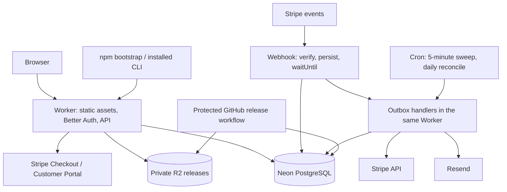

# Agent Skills commercial subscription and distribution plan

Decided: 11 September 2026. Repository baseline: `7ad3633`, version `1.0.0`.
Status: final. Every choice below is made. There are no open decisions, no alternatives to
compare, and no gates left to clear before building. Phase 00 is the next task.
Owner: Lawrence Wamala (product owner, maintainer, and operator).

## 1. The decision in one page

Agent Skills is sold as **one subscription, €11 per named developer per month**, bought by
individuals or by companies for a number of seats. Payment runs through **Stripe with Managed
Payments**, so Stripe is the merchant of record and files indirect tax in 80+ countries.
Licensing is enforced **at the distribution boundary only**: an active paid seat is required to
download and update the product. Nothing in the installed runtime blocks work.

| Concern | Decision |
| --- | --- |
| Product | One tier, one price, one capability set; seats 1-100 self-serve |
| Price | €11 per developer per month, tax-exclusive, billed monthly in advance; no tiers, no volume discounts |
| Payments | Stripe Checkout + Billing with Managed Payments enabled (Stripe is merchant of record) |
| Enforcement | Authenticated download and update; no offline lease, no runtime licence blocking |
| Portal + API | One Cloudflare Worker with Static Assets; React + Vite front end, Hono API |
| Browser identity | Better Auth in the Worker: GitHub OAuth and email OTP |
| CLI identity | Browser-approved device pairing that issues one opaque, revocable CLI token per device |
| Database | Neon PostgreSQL, EU Central region, accessed with Drizzle |
| Release storage | Private Cloudflare R2, streamed by the Worker to authorised callers |
| Background work | Durable inbox/outbox tables in PostgreSQL, driven by `waitUntil` and Cron Triggers |
| Email | Resend Pro from launch, with SPF/DKIM/DMARC on the product domain |
| Release integrity | Ed25519 manifest signatures verified by the Node bootstrap before extraction |
| Source and CI | Private GitHub repository, GitHub Actions, protected release environment |
| Commercial line | Ships as `2.0`; `1.x` keeps its current contracts and its current install path |
| Support | `support@agent-skills.dev`, best effort within two business days, Europe/Berlin, no SLA |

Three of those are the load-bearing simplifications, and each one deletes a whole class of work:

1. **Managed Payments removes the tax problem.** Stripe becomes the legal seller, calculates,
   collects, files and remits VAT, GST and US sales tax, handles disputes and first-line payment
   support. The maintainer keeps a single German business registration and pays income tax on
   Stripe payouts. VAT registration in other member states, OSS returns, invoice-format rules per
   country, and US nexus tracking are no longer this project's work.
2. **Distribution-boundary licensing removes the DRM problem.** Skills are Markdown and the
   runtime is Python and bash on the customer's own machine. No local check can survive a
   determined user, and pretending otherwise costs months of signing, lease, clock-skew, and
   revocation-overlap engineering for an effect that is not real. The subscription buys the
   registry: new releases, updates, and support. This is exactly how Sidekiq Pro, Tailwind Plus
   and Font Awesome Pro are sold, and they are sold that way by very small teams, for years.
3. **A device-paired CLI token removes the OAuth problem.** A first-party device-authorisation
   OAuth composition with rotating refresh tokens and cross-platform keyring storage is the
   single most fragile thing in a project this size. A revocable opaque token in a `0600` file is
   what `npm`, `gh` and `docker` ship, is a few hundred lines, and fails in ways a solo
   maintainer can debug at 22:00.

What that buys: the whole system is one Worker, one database, one payment provider, one bucket,
one mail provider. It can be built by one person, and it keeps working when that person is
asleep.

## 2. What is sold, and the terms it is sold under

| Policy | Behaviour at launch |
| --- | --- |
| Price | €11 per developer per month, EUR, tax-exclusive; Stripe Adaptive Pricing shows the buyer's local currency at checkout |
| Tax display | Pricing page states "€11 per developer per month, excl. VAT" and shows an inclusive example (€13.09 incl. 19% German VAT); Checkout shows the buyer's actual tax line |
| Billing | Monthly in advance; quantity is an integer 1-100; quantity 0 is not a subscription, it is a cancellation |
| Larger accounts | Above 100 seats, `sales@agent-skills.dev` arranges the same unit price manually |
| Trials | None. A 30-day money-back guarantee replaces them: email support within 30 days of a first payment and it is refunded in full, no questions |
| Discounts | None. No coupons, no annual plan, no volume tiers; a 50-seat company pays the same €11 per developer as an individual |
| Price changes | A new price is a new Stripe Price record. Existing subscribers keep their price indefinitely; 30 days' notice before any change to the published price |
| Licence unit | One named human, on as many of that person's own machines as they like; no per-device charge |
| Administrators | Owner, admin and billing-manager roles need no paid seat unless they personally use the product |
| Individual purchase | The "assign a seat to me" checkbox is pre-selected for a one-seat purchase |
| Company purchase | The owner seat is never taken silently; the purchaser chooses explicitly whether they occupy one |
| Cancellation | Effective at the end of the paid period; the portal shows the exact date and time |
| Payment failure | Stripe Smart Retries run the dunning cycle; already-paid coverage stands until it ends; nothing extra is granted after that |
| Seat reassignment | Free, immediate, audited |
| Multiple memberships | A person can belong to several billing accounts; the CLI selects one explicitly; capacity never pools across accounts |
| Automation | Local agents acting for their licensed developer are included. Shared CI runners and service accounts are not licensed and are named as such in the terms |
| Customer property | Code, prompts, configuration, knowledge bases and outputs stay the customer's, during and after the subscription |
| Support | `support@agent-skills.dev`, best effort within two business days, Monday to Friday, Europe/Berlin. No contractual uptime |

The whole price list, as it appears on the pricing page:

| Buyer | Seats | Monthly, excl. VAT |
| --- | --- | --- |
| Individual developer | 1 | €11 |
| Small team | 5 | €55 |
| Company | 10 | €110 |
| Company | 50 | €550 |

Same product, same capabilities, same price per developer at every size. The arithmetic is the
whole pricing page: seats × €11.

€11 is deliberately below the host tools it sits on top of. A buyer already pays for Claude Code,
Copilot or Cursor at roughly €20 per developer per month, and Agent Skills is a layer over that
spend rather than a replacement for it. Pricing at parity would force a comparison this product
should not invite; pricing at roughly half makes an individual purchase a same-day decision and a
ten-developer purchase a €110 line item nobody escalates. Section 12 shows the margin that
supports it, and the price-change policy above is how the number moves later without punishing
the people who bought first.

The subscription does not include LLM or API usage, host-editor subscriptions, the customer's
own infrastructure, or a warranty that generated code is correct. The pricing page and the
onboarding screen both say so in plain words.

### What the licence actually grants and enforces

An active subscription licenses current use, every release published while it is active,
private distribution access, and support. Enforcement is at the registry:

- Registry metadata, release manifests and archive downloads require a valid CLI token bound to
  a user who holds an active assigned seat on an account with settled coverage covering now.
- `agent-skills install` and `agent-skills update` fail cleanly and explain why when that is not
  true. The failure names the account, the reason, and the portal URL.
- Nothing already installed stops working. Execution Guard, diagnosis, export, logout and
  uninstall are never gated on payment, and no user file, credential or host binding is ever
  deleted to enforce a payment outcome.
- The terms state that continued use of the installed product after the subscription ends is not
  licensed, and that the remedy is renewal, not technical destruction.

Token sharing is handled the way every comparable product handles it. Tokens are per device,
revocable from the portal, rate-limited, and recorded with a device label and last-used time and
country. Abnormal fan-out is visible to the operator and is a terms breach, not a crypto problem.

### Compatibility with the existing `1.x` product

The commercial line ships as **`2.0`**. Version `1.x` keeps every frozen contract, keeps
installing from Git with no credentials, and never gains a mandatory login. Upgrading to `2.0`
is an explicit, documented, opt-in action with release notes and a migration page. There is no
patch release that suddenly requires an account.

The `1.x` quality roadmap continues in parallel: behavioural release evaluation, smaller skill
entry points, revision-aware memory, measured capability expansion. Commercial work does not
consume that budget. [1.0 contracts](one-point-oh.md), [product roadmap](../ROADMAP.md),
[current install behaviour](../README.md#install), [npm bootstrap](../npm/README.md).

Three licence files exist after phase 00:

- `LICENSE` - the repository licence, unchanged, no usage rights granted.
- `LICENSE-BOOTSTRAP` - a permissive licence covering only the public npm package, so anyone may
  run `npx @wamalalawrence/agent-skills install` before they have bought anything.
- `TERMS.md` - the subscription agreement: use rights, the named-human seat, the no-redistribution
  rule, generated-work ownership, contractor and remote-agent rules, refunds, cancellation,
  price changes, and service discontinuation.

## 3. Architecture



One private repository, one Worker, one deployment. Modules inside it: `identity`, `accounts`,
`billing`, `entitlements`, `releases`, `notifications`, `operations`. They share authorisation
helpers, the Drizzle schema and the transaction helpers. No microservices, no second runtime, no
generic licensing platform.

| Boundary | Authority | Never does |
| --- | --- | --- |
| Authentication | Better Auth identifies a user and a browser session | Infer paid access from being logged in |
| Billing | Stripe records invoices, payment outcomes and subscription configuration | Let the CLI query Stripe, or trust a payment claim from a browser |
| Membership and seats | Application transactions in PostgreSQL | Trust an account ID or role supplied by the client |
| Entitlement | Derived from settled coverage plus an active assignment | Treat a token as proof of payment |
| Release publication | The protected GitHub release workflow plus registry rows | Publish a version whose archive or signature is incomplete |
| Distribution | The registry checks live entitlement on every request | Hand out long-lived download capabilities |

Neon's serverless driver is used over HTTP for single-statement reads and over WebSockets for
the interactive transactions that seat allocation needs. A WebSocket connection never outlives
its request, and every request-scoped connection is closed in a `finally`. Seat allocation is
one transaction that takes `SELECT ... FOR UPDATE` on the billing-account row; it is never
spread across two HTTP round trips. [Neon serverless driver](https://neon.com/docs/serverless/serverless-driver).

The database lives in Neon's EU Central region. That is a latency and data-location preference,
not an EU-only processing claim: edge execution, logs, mail and payments each have their own
locations, and the data inventory in section 12 records all of them.

## 4. Identity, accounts, and the CLI token

### Browser identity

Better Auth runs inside the Worker with two sign-in methods: **GitHub OAuth** and **email OTP**
(a six-digit code, not a magic link, so corporate link-scanners cannot consume it). Sessions use
`Secure`, `HttpOnly`, `SameSite=Lax` cookies with explicit trusted origins, CSRF protection on
every state change, a 7-day idle expiry and a 30-day absolute expiry. Ownership transfer and
billing-detail changes require re-authentication within the last 10 minutes.

Account linking requires proof of both identities through Better Auth's own trusted-linking
mechanism. A matching email string is never enough. Email addresses are compared case-insensitively
on the domain and case-sensitively nowhere; no Gmail-style dot or plus normalisation is applied.
[Better Auth Drizzle adapter](https://better-auth.com/docs/adapters/drizzle).

### CLI token

`agent-skills login` runs a three-step pairing flow that this project owns end to end:

```text
CLI                          Worker                         Browser
 |-- POST /api/v1/cli/pair -->|  creates pairing: code, 10-min expiry
 |<-- code + approval URL ----|
 |   opens browser / prints URL and code
 |                            |<-- user signs in, sees device label, approves --|
 |-- POST /api/v1/cli/pair/poll (every 5s, honours retry-after) -->|
 |<-- one-time CLI token -----|  256-bit random, stored only as SHA-256
```

Decisions that make this safe and boring:

- The token is opaque, 256 bits from `crypto.getRandomValues`, shown once, stored server-side
  only as a SHA-256 digest, and revocable individually or all-at-once from the portal.
- It does not expire on a timer. It dies when revoked, when the user's membership ends, or after
  180 days of no use.
- It carries no billing authority. It can read `me`, read release metadata, and download
  archives. It cannot invite, assign, purchase, cancel, or change roles.
- The approval screen names the device label, the machine hostname, and the account, and requires
  an explicit click. Denied, expired and reused pairing codes return the same generic response and
  never appear in logs.
- Headless and remote terminals get the URL and code printed; there is no callback listener and
  no token in any redirect URL.
- Storage is `~/.config/agent-skills/credentials.json`, mode `0600`, directory `0700`, written
  atomically through a temp file and rename. No keyring dependency, so macOS, Linux and WSL2 all
  work on day one with zero extra packages.
- `agent-skills logout` revokes the token server-side and removes the file. Offline, it removes
  the file and says plainly that the server-side revocation still needs the portal.

New commands: `login`, `logout`, `account`, `license status`. All of them keep the frozen
structured-JSON output shape, the stable error codes, and bounded timeouts.

### Roles

| Action | Owner | Admin | Billing manager | Member |
| --- | --- | --- | --- | --- |
| View own seat and devices | Yes | Yes | Yes | Yes |
| View account membership | Yes | Yes | Names and seat counts only | Own membership only |
| Invite and remove members, assign and revoke seats | Yes | Yes | No | No |
| Payment details, invoices, cancellation | Yes | No | Yes | No |
| Change seat quantity | Yes | No | Yes | No |
| Assign roles, transfer ownership | Yes, with re-authentication | No | No | No |
| Delete the billing account | Yes, after the subscription has ended | No | No | No |

There is exactly one active owner. An owner cannot drop their own ownership until a named
recipient has accepted a transfer. Deleting a person's login is a different operation from
cancelling an account's subscription, and neither deletes invoice records Stripe must retain.

### Invitations

Invitations last seven days, are single-use and revocable, and are stored as a hash of the token
rather than the token. Re-sending invalidates the previous one. One pending invitation per
(account, email) at a time.

An invitation does not reserve capacity. Acceptance and seat assignment happen in one
transaction under the account row lock. If the last seat went to someone else first, the
accepter sees: *"Your invitation is valid, but an administrator needs to free or buy a seat."*
The invitation token is not consumed, so the retry works later. Administrative invitations that
do not request a seat never touch capacity.

Revoking a seat leaves membership intact. Removing membership revokes that account's assignment
and that account's download rights, and touches neither the person's login nor their other
memberships.

## 5. Data model and invariants

Better Auth owns its generated identity, session and account tables, with reviewed migrations
pinned to the installed version. The application tables are:

| Table | Contents and constraints |
| --- | --- |
| `billing_accounts` | ID, display name, unique Stripe customer ID, lifecycle state |
| `account_memberships` | Account, user, role, status; unique per (account, user); partial unique index enforcing one active owner |
| `invitations` | Account, invited email, role, `requests_seat`, token hash, expiry, inviter, acceptance or revocation |
| `subscriptions` | Unique Stripe subscription and item IDs, account, price ID, observed status and quantity, period bounds, `cancel_at_period_end`, last reconciliation |
| `paid_coverage` | Subscription item, invoice ID, invoice line ID, half-open interval, capacity, settlement time; unique on (invoice line) |
| `seat_assignments` | Account, user, assigned and revoked timestamps, actor, reason; partial unique index on (account, user) where `revoked_at is null` |
| `cli_tokens` | User, device label, token hash, created, last used, last-used country, revoked |
| `release_versions` | Version, platform, channel, R2 keys, archive SHA-256, payload tree hash, signing key ID, minimum bootstrap version, state; unique on (version, platform) |
| `stripe_events` | Unique Stripe event ID, type, related object IDs, received, processed, attempts, redacted last error |
| `outbox_jobs` | Unique effect key, kind, payload reference, state, attempts, run-after, claim token, claim expiry |
| `audit_events` | Actor, account, action, target, timestamp, result; append-only to the application role |
| `legal_acceptances` | User, account, terms version, timestamp |

No row-per-purchased-seat table. Capacity is a number and assignments are rows; that is enough.
Revocations are preserved rather than overwritten.

The invariants the implementation must hold:

1. One non-terminal subscription per billing account. Checkout is idempotent on a recorded
   operation key, so a double click cannot create a second subscription.
2. Money is currency plus integer minor units. Time is UTC, intervals are half-open `[start, end)`,
   and the UI renders local time with its zone.
3. `paid_capacity(now)` is the quantity of the **most recently issued settled invoice line whose
   period covers `now`** for the allowlisted product's subscription item, and is additionally
   clamped to the live `subscription.items[0].quantity` when that is lower. It is never a sum of
   events and never a sum of overlapping intervals.
4. Seat allocation reads capacity and counts active assignments inside one transaction that holds
   `FOR UPDATE` on the same `billing_accounts` row that revocation, acceptance and coverage
   updates lock.
5. Assignments may exist while an account is unpaid. They simply grant nothing, because
   entitlement also requires applicable coverage.
6. A user is entitled when the user is enabled, the membership is active, the assignment is
   active, and settled coverage includes `now`. A role alone grants nothing.
7. Stripe IDs, event IDs and operation keys are unique within their environment.
8. Every grant, revocation and quantity change commits an audit row in the same transaction as
   the state change.
9. Every payment operation and every email effect is keyed so that a retry cannot double-charge,
   double-grant, or double-send.

## 6. Billing

One Stripe Product, one recurring monthly EUR Price, product tax code
`txcd_10103101` (SaaS - electronic download - business use). Price IDs live in Worker config and
are allowlisted; the browser sends a quantity and an account ID, never a price.

Managed Payments is enabled on the account, which fixes several things by design: subscriptions
are created only through Checkout, out-of-cycle invoices are not available, custom domains are
not used on the checkout page, and the customer's statement shows `LINK.COM*`. The plan below is
built around those constraints rather than against them.
[Managed Payments](https://docs.stripe.com/payments/managed-payments),
[eligibility](https://docs.stripe.com/payments/managed-payments/eligibility),
[how it works](https://docs.stripe.com/payments/managed-payments/how-it-works).

### Initial purchase

1. The user signs in, picks or creates a billing account, sets the quantity, and ticks or unticks
   "assign a seat to me".
2. The server checks the caller's billing permission, validates the quantity, and writes a
   pending `billing_operations` row with an idempotency key derived from (account, quantity, seat
   choice, day).
3. The server creates or reuses the Stripe customer and opens a Checkout Session carrying the
   account ID in metadata. A repeat click returns the same live session.
4. Checkout collects payment. The return page reads **"Payment received - activating"** until the
   server has recorded settled coverage. The browser never activates anything.
5. The webhook handler verifies the subscription and the settled invoice, writes `paid_coverage`,
   and assigns the purchaser's seat if the recorded operation asked for it.
6. The portal flips to active, typically within a couple of seconds. An abandoned or expired
   checkout grants nothing and can simply be retried.

### Payment state to entitlement

| Situation | Entitlement |
| --- | --- |
| Checkout finished, invoice not yet settled | Pending, no access |
| Settled invoice line for the item covers now | Capacity active, subject to assignments |
| Subscription says `active` but no settled line covers now | Pending; reconcile; never infer payment |
| Renewal fails while the previous paid period still runs | Previous coverage stands; billing banner shown |
| Coverage ended unpaid, or status is `past_due` or `unpaid` | Downloads and updates blocked; installed product untouched |
| `incomplete` or `incomplete_expired` | No grant; alert if unexpected |
| Cancel at period end | Coverage runs to the boundary, then stops |
| Immediate cancellation or fraud suspension | Server access denied from that moment |
| Payment recovers after an interruption | Recompute coverage; existing assignments reactivate automatically |
| Full refund of a rescinded period | Invalidate that coverage row; keep the invoice and audit evidence |
| Partial goodwill refund | Coverage is untouched; the operator records the decision |
| Dispute or chargeback | Suspend new grants for that account pending review, under the published terms; delete nothing |

A settled zero-amount invoice funded by account credit counts as settlement. `amount_paid > 0`
is never the test. The Stripe API version is pinned in code, and the payload is mapped into the
internal model at the boundary so a Stripe schema change is a one-file change.
[Subscription webhooks](https://docs.stripe.com/billing/subscriptions/webhooks).

### Seat increases

Increases call `subscriptions.update` with `proration_behavior: 'create_prorations'`. Capacity
goes up immediately and the prorated amount appears on the next regular invoice. This is what
Managed Payments supports, and it is also simpler: there is no pending-payment state, no failed
mid-cycle upgrade path, and no half-applied capacity. The exposure is bounded to one month of
added seats on an account that already has a working payment method, and an unpaid renewal stops
everything at the boundary. The portal shows a server-generated preview of the prorated amount
and the new recurring total before the click.

### Seat decreases

Decreases call `subscriptions.update` with `proration_behavior: 'none'`. No credit, no refund,
and the smaller amount starts at the next renewal - the same behaviour developers already know
from GitHub Copilot and Google Workspace. Because capacity is derived from the settled invoice
line, the current period keeps the capacity that was paid for, and capacity drops by itself at
renewal. No schedules, no pending-reduction table, no race between a schedule and a cancellation.

If assignments still exceed capacity at renewal, the renewal handler revokes the most recently
assigned seats until they fit, writes audit rows, and emails the owner and each affected person.
Deterministic, and it never blocks the renewal.

The Stripe Customer Portal is enabled for payment methods, billing details, invoices and
end-of-period cancellation only. Quantity editing is disabled there, because the portal cannot
enforce the assignment invariants. Customers also get Link's own order-management page, which
Managed Payments provides automatically.

### Refunds and support

The money-back guarantee is a policy, not code: the operator refunds the charge in the Stripe
dashboard, and the webhook invalidates the matching coverage row. Under Managed Payments, Stripe
answers transaction-level support through Link and may itself refund within 60 days; the
maintainer's support address is kept current in the dashboard, and an escalation that gets no
answer within 48 hours may be refunded by Stripe without asking. That is accepted.

## 7. Events, background work, and reconciliation

`POST /api/webhooks/stripe` reads the raw body, checks its size, and verifies the signature with
Stripe's SDK and the environment's endpoint secret before anything else. Then:

1. One transaction inserts the `stripe_events` row and the deduplicated `outbox_jobs` rows. A
   duplicate delivery finds the existing row and returns 200.
2. The handler returns 200 and passes the processing promise to `ctx.waitUntil`, so the common
   case completes in under a second without a queue service.
3. The processor claims each job with an expiring claim token, so a retry and a slow first
   attempt cannot both apply the same effect.
4. Authoritative Stripe state is fetched outside the write transaction, then applied only if the
   claim is still held and the subscription's stored version has not moved on.
5. One transaction updates billing state, recomputes coverage, appends audit rows, enqueues
   notification effects, and marks the job done.
6. Transient failures retry with exponential backoff and jitter, six attempts, then the job is
   parked in a `failed` state that raises an alert and can be replayed from the operator page.

Stripe does not guarantee order and does redeliver. The design does not need ordering: every
effect is keyed, and the reconciler is the backstop.

Schedules, all Cron Triggers on the same Worker:

- Every 5 minutes: sweep `outbox_jobs` that are runnable, stranded, or past their claim expiry.
- Every hour: reconcile pending purchases and subscriptions changed in the last 26 hours, in
  bounded batches with a persisted cursor and overlap protection.
- Daily at 03:00 UTC: walk every non-terminal subscription and assert capacity, coverage and
  assignment invariants; log and alert on drift.
- On the pending-purchase page, a rate-limited "check again" button triggers one reconciliation.

Entitlement is evaluated against the clock on every request, so nothing depends on a cron job
firing exactly at a billing boundary. If the database is unreachable or state is inconsistent,
new grants are denied with a recoverable error; no grant is ever invented because a provider is
down. [Stripe webhooks](https://docs.stripe.com/webhooks).

## 8. Private registry and safe releases

R2 is private: public bucket access and public development URLs are off. Clients never receive
R2 credentials. Downloads go through an authenticated Worker route that streams the object from
an R2 binding, checks entitlement before the first byte and on every resumed range request, and
never buffers a whole archive in memory. There are no presigned URLs.
[R2 Workers API](https://developers.cloudflare.com/r2/api/workers/workers-api-usage/).

| Endpoint | Caller and behaviour |
| --- | --- |
| `GET /api/v1/me` | Session or CLI token; own memberships, seats and devices |
| `POST /api/v1/billing/checkout` | Owner or billing manager; idempotent |
| `POST /api/v1/billing/portal` | Owner or billing manager; server picks the customer and the return URL |
| `POST /api/v1/accounts/{id}/quantity` | Owner or billing manager; preview-confirmed |
| `POST /api/v1/accounts/{id}/invitations` | Owner or admin; rate limited |
| `POST /api/v1/invitations/accept` | Verified recipient; transactional |
| `POST /api/v1/accounts/{id}/assignments` | Owner or admin; capacity checked under lock |
| `DELETE /api/v1/accounts/{id}/assignments/{id}` | Owner or admin; audited |
| `POST /api/v1/cli/pair`, `/pair/poll` | Anonymous, rate limited, generic failures |
| `GET /api/v1/releases/latest?channel=stable` | CLI token with a live entitlement check |
| `GET /api/v1/releases/{version}` | CLI token; signed manifest |
| `GET /api/v1/releases/{version}/archive` | CLI token; entitlement checked, then streamed |
| `POST /api/webhooks/stripe` | Signature-verified; no session accepted |
| `POST /api/internal/releases` | Release-publisher credential only; not reachable from any user session |

Version, platform and channel are validated against registry rows; nothing from a request is
ever interpolated into an R2 key, a shell command or an outbound URL. Unknown and unauthorised
resources return the same non-disclosing response. Status codes: `401` missing or expired
identity, `403` known lack of entitlement, `409` state conflict, `429` with retry guidance, `503`
dependency failure - each mapped to the frozen CLI exit codes. Authenticated responses are
`private, no-store`.

### Signing and verification

Release integrity uses **Ed25519**, verified by `node:crypto` in the existing Node bootstrap
before the Python install engine ever sees the archive. Node 18 is already the engine floor, so
this adds no dependency on either side, on any platform.

The signed manifest covers: version, channel, source commit, platform, archive SHA-256, archive
byte size, payload tree hash, creation time, manifest schema version, minimum bootstrap version,
and signing key ID. It is signed over a canonical JSON serialisation. Verification order is
always: signature, then archive digest, then extraction, then self-test, then activation. The
existing payload-tree verification stays and runs in addition.

Bounds enforced before and during extraction: archive size, expanded size, file count, path
length, compression ratio. Rejected outright: path traversal, symlinks escaping the root, device
files, duplicate or case-colliding entries, and setuid or setgid modes. Any failure leaves the
previous installation and its host registrations exactly as they were.

The signing key exists only as a GitHub Actions environment secret on a protected environment
that requires review to deploy. The public trust bundle ships inside the npm bootstrap and the
installed release, and holds **two** keys, so rotation is: publish a bootstrap version carrying
old and new, wait for adoption, start signing with the new, drop the old in the version after.

Object layout, never overwritten:

```text
releases/<version>/<platform>/<archive-sha256>.tar.gz
releases/<version>/<platform>/manifest.json
releases/<version>/<platform>/manifest.sig
```

Publication uploads and verifies readability first, then flips the registry row from `staged` to
`published` and moves the channel pointer in one transaction. A partial upload is invisible.
A fix is a new version; a withdrawal hides a version from new installs and records the reason.
The client refuses a silent downgrade, and an explicit rollback to a retained local version stays
available as a recovery tool. [Release providers](release-providers.md).

The registry provider is implemented under the existing `ReleaseProvider` seam, keeping its four
operations and its transaction stages, using the established `PremiumRegistryProvider` naming.

### npm package boundary

The public tarball contains the bootstrap, the pairing client, the Ed25519 verifier, the install
engine, their dependencies, public metadata, and `LICENSE-BOOTSTRAP`. The `files` allowlist stays
positive, and the release workflow inspects the actual `npm pack` output for source maps,
fixtures, private docs, skills, env files, test credentials and vendored extras. This extends the
existing package audit rather than replacing it.

CI runs on protected branches and tags with immutable action pins, minimum token permissions, no
production secrets in pull-request jobs, and separate staging and production publisher
identities. Signing jobs never run unreviewed code. Every release records build provenance, the
dependency inventory, artifact digests and the signer identity.
[GitHub Actions secure use](https://docs.github.com/en/actions/reference/security/secure-use).

## 9. Portal, email, and the first run

Pages: home and pricing, help, sign in, account and devices, billing, seats, invitations,
download and onboarding, terms and privacy and imprint, status. That is the whole site.

Every page is keyboard operable, has labelled controls, meets WCAG AA contrast, works at 320px,
and announces pending and error states to screen readers. This is verified with a real browser
and a real screen reader before launch, not assumed from the component library.

Explicit designed states: no memberships yet, owner without a seat, payment pending, invitation
accepted after capacity ran out, subscription ending, renewal failed, subscription cancelled,
device revoked, unsupported machine, registry outage. The seats page always shows purchased
capacity and assigned seats side by side.

First run:

```text
npx @wamalalawrence/agent-skills install
  → check prerequisites
  → agent-skills login: pairing code, browser approval
  → choose the account holding your seat
  → fetch and verify the signed manifest
  → download, verify digest, stage, self-test, activate, reconcile hosts
  → print one real task to try
```

Someone without a seat gets the account, invitation and purchase links and downloads nothing
protected. A billing owner without a seat gets a one-click "assign a seat to yourself".

Email runs on Resend Pro from launch - the free tier's 100/day ceiling is reachable by a single
invitation batch, and login codes cannot be rate-limited by a billing plan. SPF, DKIM and DMARC
are configured on `agent-skills.dev` with a dedicated sending subdomain, plus bounce and
complaint handling and a suppression list. Auth emails carry no tracking pixels and no click
rewriting, and no token ever appears in a log line. [Resend pricing](https://resend.com/pricing).

| Sender | Messages |
| --- | --- |
| Better Auth via Resend | Login codes, security and recovery notices |
| Application via the outbox | Invitations, ownership transfer, seat revocation, renewal seat trimming |
| Stripe and Link | Receipts, invoices, renewal reminders, payment failure, cancellation confirmation |

Billing mail comes from Stripe only, so nothing is duplicated. Account mail is not marketing
consent, and there is no marketing list at launch.

The operator page is small and audited: find an account by verified identifier, view redacted
billing and entitlement history, replay a failed job, resend an invitation, revoke a device, and
record a refund decision. No shared SQL console, no impersonation, no hand-editing of coverage.

## 10. Security and privacy

Threats designed against in every phase: cross-account access, invitation theft, session
takeover, forged payment state, webhook replay, leaked download capability, malicious archive,
signing-key compromise, and provider outage.

Controls: validation at every boundary; parameterised queries only; a permission check on every
resource by ID; CSRF, origin and cookie controls; request, body and response size limits; rate
limits per user, per account, per operation and per IP prefix; secrets in Worker secret storage,
never in source; TLS everywhere; dependency and secret scanning in CI; a non-owner application
database role plus a separate migration role.

Never logged: tokens, pairing codes, invitation codes, email addresses, billing addresses, raw
Stripe bodies, customer source, prompts. Errors carry a safe code and a correlation ID.

Operational logs are kept 30 days; audit events 180 days; financial records for the period German
law requires of the maintainer's own business. Audit rows use internal IDs and are treated as
sensitive even though they are pseudonymous.

A data inventory is written in phase 00 and maintained: every provider, the fields it holds, the
purpose, the retention, who can read it, how it is exported, how it is deleted, where backups
live, and each subprocessor's location. Product telemetry stays local by default; there is no
remote telemetry at launch. Commercial licensing authorises no collection of customer
repositories or prompts, and the terms say so.

Under Managed Payments, Stripe handles indirect-tax compliance in 80+ countries, fraud, disputes
and transaction support, and may action a customer data-deletion request that cancels their
subscription and erases their payment objects. The maintainer's own remaining obligations are: a
German business registration, income tax on payouts, a German `Impressum`, a privacy notice, a
DPA offer for business customers, and the terms. A single paid session with a German accountant
and a German lawyer in phase 00 confirms the entity form and reviews those three documents.
That is a scheduled task with a date, not a condition on starting work.

## 11. Environments, operations, and recovery

Three environments - local, staging, production - with separate Neon projects and roles, R2
buckets, Worker bindings, auth clients, Stripe test and live keys, webhook secrets, signing keys,
sending domains and hostnames. Production data never enters a preview deployment, and preview
deployments cannot read production secrets or the release bucket.

Infrastructure is versioned in `wrangler.toml` and reviewed. Migrations are serialized, run as a
deployment step under the migration role, and follow expand-then-contract so two Worker versions
can coexist. A rollback never drops a live column.

| Failure | Behaviour |
| --- | --- |
| Neon unavailable | Mutations and new grants return a recoverable error; the webhook fails so Stripe retries; installed products are unaffected |
| Stripe unavailable | Nothing is guessed; pending changes wait; existing coverage still authorises downloads; the reconciler catches up |
| Resend unavailable | The outbox retries; the portal shows the pending send and a resend control |
| R2 or registry unavailable | Install and update fail safely; the currently installed version keeps working |
| Bad Worker deployment | Roll back to the previous version; inbox and outbox rows survive; check schema compatibility first |
| Bad release | Withdraw it from the channel, publish the fix, users can roll back locally |
| Signing key compromised | Halt publication, rotate through the two-key trust bundle, publish a new bootstrap, no unsigned fallback |
| Database restored from backup | Freeze job processing, reconcile against Stripe, re-apply revocations, invalidate stale sessions, then resume grants |

Recovery targets: RPO one hour and RTO four hours for account and seat state, during the
supported response window. These are internal targets, not an advertised SLA. They are met by
Neon's point-in-time restore plus a nightly `pg_dump` written by a Cron Trigger to a dedicated R2
bucket with a 30-day lifecycle, in a separate Cloudflare account from the release bucket. A
restore drill into an isolated environment runs before beta and every quarter after, and the
drill explicitly verifies that invitations, assignments, revocations and audit rows came back -
Stripe can rebuild billing history but not those.

Monitoring, with Better Stack watching `/health` and `/api/v1/releases/latest` from two regions:

| Signal | Target and action |
| --- | --- |
| Checkout to active entitlement | 95% inside 60s; investigate anything pending over 5 minutes |
| Entitlement API latency | p95 under 1s warm, from beta user regions; cold starts measured separately |
| Oldest runnable job / failed jobs | Alert above 5 minutes / on any failed job |
| Reconciliation | Alert after two missed runs; record drift and repairs |
| Authorisation and signature failures | Alert on spikes, with codes and counts only |
| Install and update failures | Segmented by release, OS and stage |
| Provider spend | Notify at 50%, 80% and 100% of the €120/month budget; these are alerts, not caps |

`/health` returns without touching the database. Only the cron sweep and real traffic reach Neon.

## 12. Cost and margin

Prices checked 11 September 2026. Infrastructure figures are USD and exclude tax, FX and labour.

| Component | Basis |
| --- | --- |
| Workers Paid | $5/month including 10M requests and 30M CPU-ms; static asset requests are free |
| Neon Launch | $0.106/CU-hour plus $0.35/GB-month; the 5-minute cron keeps compute awake, so budget 24/7 |
| R2 Standard | $0.015/GB-month, $4.50/M Class A, $0.36/M Class B, no egress charge |
| Resend Pro | $20/month, 50,000 emails |
| Better Stack | Free tier |
| Domain | ~$2/month |
| GitHub | Existing plan plus private Actions minutes and artifact storage |

[Workers pricing](https://developers.cloudflare.com/workers/platform/pricing/),
[Neon pricing](https://neon.com/pricing),
[R2 pricing](https://developers.cloudflare.com/r2/pricing/).

Production, 1 GB database, 20 GB releases, 0.25 CU awake continuously:
`$5 + (0.25 × 24 × 30 × $0.106 = $19.08) + $0.35 + $0.30 + $20 + $2 = $46.73/month`.
Staging adds about $8. **Budget €55/month fixed at launch, €120/month as the alert ceiling.**

Per-seat margin on a single seat at €11 excl. VAT, German consumer at 19% VAT, gross €13.09:

```text
Managed Payments  3.5% × €13.09 = €0.46
Card processing   1.5% × €13.09 + €0.25 = €0.45
Stripe Billing    0.7% × €11.00 = €0.08
                                  -------
fees                              €0.98   →  net €10.02 per seat per month
```

The €0.25 fixed fee is per invoice, not per developer, so larger accounts net slightly more per
seat:

| Invoice | Gross | Fees | Net | Net per seat |
| --- | --- | --- | --- | --- |
| 1 seat, €11 | €13.09 | €0.98 | €10.02 | €10.02 |
| 5 seats, €55 | €65.45 | €3.91 | €51.09 | €10.22 |
| 10 seats, €110 | €130.90 | €7.57 | €102.44 | €10.24 |
| 50 seats, €550 | €654.50 | €36.83 | €513.17 | €10.26 |

**Break-even is six paid seats.** One ten-developer company covers the infrastructure and the
annual adviser session with room to spare. [Stripe Germany pricing](https://stripe.com/de/pricing),
[Managed Payments pricing](https://support.stripe.com/questions/managed-payments-pricing).

Track support minutes per account next to infrastructure spend. A €10 hosting saving that costs
an hour of account recovery is a loss.

## 13. Test matrix

The existing installer, provider and package tests stay. Added tests run against a real
PostgreSQL instance for concurrency, Stripe test mode and test clocks for billing, and a deployed
staging Worker for anything provider-specific. [Stripe billing testing](https://docs.stripe.com/billing/testing).

| Area | Scenarios that must pass |
| --- | --- |
| Browser identity | Login, logout, OTP to the wrong recipient, link-scanner fetch, session expiry, CSRF, cross-origin, account linking, owner recovery |
| CLI pairing | Clean machine, approval, denial, expiry, reuse, headless, concurrent logins, revoked token, `0600` enforcement, atomic write interrupted |
| Initial billing | One seat, five seats, purchaser without a seat, abandoned checkout, double click, duplicate webhook, payment settled before the event arrives |
| Renewals | Paid renewal, authentication required, failed renewal, recovered payment, settled zero-amount invoice, cancel at period end |
| Quantity | Increase applies immediately and bills next cycle; decrease holds capacity to the boundary then drops; assignments over capacity trimmed deterministically at renewal |
| Concurrency | Two acceptances for the final seat; assign racing revoke; double checkout; a stale reconciliation losing to a newer one |
| Authorisation | Member cannot administer; billing manager cannot assign; CLI token cannot touch billing; foreign IDs reveal nothing |
| Registry | Anonymous denied, expired coverage denied, revoked assignment denied, no public R2 path, range-resume re-checked, path injection rejected |
| Signing | Bad signature, wrong key, unknown key ID, tampered archive, wrong version or platform, oversized and malicious archives, two-key rotation |
| Installer | Interrupted activation, failed self-test, rollback to a retained version, bootstrap below minimum version, previous install intact after every failure |
| Local safety | A lapsed subscription leaves guard, diagnosis, export and uninstall working and deletes nothing |
| CI and npm | Tarball allowlist, no secrets or source maps, protected publisher, partial release stays unpublished |
| Operations | Stranded job swept, duplicate effect suppressed, failed job replayed, missed webhook repaired by reconciliation, restore drill verified |
| Commercial UX | Real price and tax shown, invoices reachable, every designed empty and error state, keyboard and screen-reader passes |

Launch requires: every money, authorisation, signature and data-preservation scenario passing
with retained evidence; no unresolved critical or high defect; one real install, update and
rollback on macOS, on Linux and in WSL2; one rehearsed restore; and the terms, privacy notice and
imprint published. Severity is defined by impact, never by how hard the fix looks.

## 14. Build order

Fourteen phases. Each one ends with tests, a code review, and a pull request into `main`; none is
blocked on a decision, because there are none left. Effort is a solo-maintainer estimate.

| ID | Deliverable | Done when | Est. |
| --- | --- | --- | --- |
| 00 | Commercial foundation | Domain registered; Stripe account with Managed Payments and the tax code set; Cloudflare, Neon and Resend accounts open; legal documents drafted | 1 wk |
| 01 | Worker skeleton | Local, staging and production deploy from CI; static assets served; `/health` green; structured logging with redaction; secrets separated per environment | 1 wk |
| 02 | Schema and migrations | Every table and constraint from section 5 live on Neon; application and migration roles separated; a `FOR UPDATE` transaction proven from the deployed Worker | 1 wk |
| 03 | Browser identity | Better Auth with GitHub OAuth and email OTP; sessions, CSRF, re-authentication, account linking; Resend wired with SPF, DKIM, DMARC | 1.5 wk |
| 04 | Accounts, roles, invitations | Role matrix enforced server-side with negative tests; invitations issued, accepted, revoked, expired; audit rows on every change | 1.5 wk |
| 05 | Durable events and jobs | `stripe_events` and `outbox_jobs` with claims, retries, failure state; `waitUntil` path plus the 5-minute sweep; alerting on job age | 1 wk |
| 06 | Checkout and coverage | One-seat and five-seat purchases activate correctly; duplicate clicks and duplicate events are safe; the pending page reconciles on demand | 1.5 wk |
| 07 | Renewals and cancellation | Test-clock coverage for paid renewal, failed renewal, recovery, cancel-at-period-end and refund invalidation | 1 wk |
| 08 | Seats | Assignment and revocation under the account lock; final-seat race resolved; quantity increase and decrease with the section 6 semantics; renewal trimming | 1.5 wk |
| 09 | Portal | Every page and every designed state in section 9; accessibility verified with a browser and a screen reader | 2 wk |
| 10 | CLI pairing and token | `login`, `logout`, `account`, `license status`; `0600` atomic storage; revocation from the portal; headless flow | 1 wk |
| 11 | Signing and verifier | Ed25519 signing in the release workflow; `node:crypto` verification in the bootstrap; extraction bounds; two-key rotation fixture | 1.5 wk |
| 12 | Registry and provider | Private R2 streaming with live entitlement checks; `PremiumRegistryProvider` under the existing seam; the bootstrap installs on a clean machine; rollback safe | 2 wk |
| 13 | Release pipeline and operations | Atomic staged-to-published promotion; package audit and provenance; operator page; nightly dump, restore drill, runbooks, monitors | 1.5 wk |

Phase 00 also books the single accountant and lawyer session described in section 10, and starts
the data inventory. Both run alongside phases 01-05 and block nothing.

Roughly nineteen focused weeks. The **first demonstrable slice is phases 00-06 plus 10-12**: one
paid developer, browser and device login, verified private install, verified update. Get that
working end to end before finishing team administration and the portal polish.

Work lands on short-lived branches off `main` via pull request, never directly on a release
branch. `feature/commercial-roadmap` carries this plan only.

## 15. Beta and launch

**Closed beta.** Eight external developers: two individual buyers, two multi-seat companies, one
billing-only owner, spread across macOS, Linux and WSL2. Four weeks. Beta access is granted as a
recorded complimentary assignment with an explicit expiry and reason - never a faked Stripe
invoice. Week three switches the two companies to real paid subscriptions.

Measured: signup to first successful install, first real task completed, checkout to activation
delay, invitations sent and accepted, successful updates, support contacts and minutes, false
entitlement denials, and actual service cost. Counts and denominators are reported as counts; a
sample of eight does not produce a percentage SLA. Every buyer is asked directly whether €11 and
the seat and refund policy fit their real work.

Beta exits when each represented workflow has completed at least once, at least one renewal and
one cancellation have run, and no money, security or data-loss defect is open.

**Launch.** Publish the terms, privacy notice, imprint, pricing, supported-platform matrix,
status page and audited bootstrap. Review production bindings, signing trust, live payment mode,
DNS and mail records, backup access and alert recipients one final time. Announce, then watch
activation and support personally through the first week.

Monthly after that: activation, support load, refunds, churn split by cancellation versus payment
failure, seat utilisation, update adoption, and net revenue. Annual billing, more currencies,
machine identities, SSO and SCIM are separate future plans, opened only when a paying customer
asks and the margin supports the work. `1.x` quality work continues throughout.

## 16. Out of scope

No feature tiers, volume discounts, annual commitments, free trials, CRM, mobile app, analytics
dashboard, custom card forms, custom invoicing, SAML or SCIM, nested organisations, domain
auto-enrollment, usage-based billing, per-command licence calls, offline lease tokens, or DRM of
any kind. Remote and cloud agent licensing is a future plan, not something the local token design
quietly covers. Customer project secrets are never migrated into this service.

## 17. Sources

Repository: `README.md`, `ROADMAP.md`, `LICENSE`, `npm/package.json`, `npm/README.md`,
`docs/release-providers.md`, `docs/one-point-oh.md`, and `lib/asrelease/`.

Product comparables researched for the licensing model: Sidekiq Pro and Enterprise, which sell a
subscription giving access to a private gem server and perform no runtime licence check at all;
Tailwind Plus, which licenses one named individual and distributes through an authenticated npm
scope; and Keygen, whose machine-activation, heartbeat and signed offline-licence-file machinery
is what this project deliberately does not build. GitHub Copilot's seat model - prorated
increases, decreases effective at the next cycle, immediate unassignment - is the seat behaviour
adopted in section 6.

Platform documentation: [Managed Payments](https://docs.stripe.com/payments/managed-payments),
[Managed Payments eligibility](https://docs.stripe.com/payments/managed-payments/eligibility),
[Stripe subscription webhooks](https://docs.stripe.com/billing/subscriptions/webhooks),
[Stripe billing testing](https://docs.stripe.com/billing/testing),
[Workers static assets](https://developers.cloudflare.com/workers/static-assets/),
[Hono on Workers](https://hono.dev/docs/getting-started/cloudflare-workers),
[Better Auth Drizzle adapter](https://better-auth.com/docs/adapters/drizzle),
[Neon serverless driver](https://neon.com/docs/serverless/serverless-driver),
[R2 Workers API](https://developers.cloudflare.com/r2/api/workers/workers-api-usage/),
[GitHub Actions secure use](https://docs.github.com/en/actions/reference/security/secure-use).
