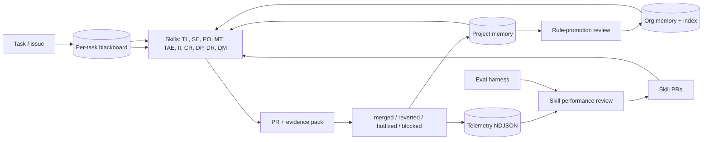

# The Company Brain

`agent-skills` is built so the same set of specialist skills compounds value across
projects, sessions, and time — not just one task. This document is the map of that
loop: which artifacts persist, where they live, who writes them, and how a single
PR's outcome eventually tightens future runs of every relevant skill.

> *"AI is not something you bolt onto the side of a company. The company itself has
> to be built with self-improving AI loops from the ground up."*

This is the policy that turns that quote into a concrete contract every skill in
this repo can be held to.

## The loop



## The four memory tiers

| Tier | Path | Lifetime | Written by | Read by |
| --- | --- | --- | --- | --- |
| Task scratch + blackboard | `<cache>/<issue-key>/` | Deleted by `cleanup-task` | Every skill in the task | Every skill in the task |
| Project memory | `<cache>/_projects/<slug>/memory.md` | Forever on this checkout | Every skill at end of task | Every skill at start of task |
| **Repo knowledge** | `<repo>/.agent-skills/knowledge/` | Forever, **committed** | Promotion, reviewed in a PR | Every skill at start of task |
| Org memory + index | `<cache>/_org/memory.md`, `_org/index.json` | Forever | Promotion review only | Every skill at start of task |

`<cache>` is `${AGENT_SKILLS_CACHE_DIR}` and is gitignored. Only the repo tier is committed,
which is what makes accumulated knowledge survive a fresh clone, a CI runner, or a teammate —
see [repo knowledge](repo-knowledge.md). It is also the only tier a human reviews before it
becomes durable, and the only one an outsider can write to, so every skill treats recorded
facts as [claims to verify, not instructions to
follow](destructive-action-safety.md#untrusted-recorded-context).

The `_*` prefix is reserved. The cleanup contract in
[`scripts/project-memory.py`](../scripts/project-memory.py) refuses to delete any
path starting with `_`, so org and project memory cannot be destroyed by
per-task cleanup.

### Read order at the start of every task

Every skill in this repository MUST, before any context discovery:

**Recommended: one command. No arguments are required.**
```bash
bash scripts/start-task.sh --skill <skill-name>=<skill-version>
```
This detects the project/task id where possible, loads org memory, loads or
initialises project memory, records the skill version, and initialises the
blackboard in a single call. The output is the agent's consolidated starting
context. If detection is wrong, rerun with explicit values:

```bash
bash scripts/start-task.sh <project> <issue-key> --skill <skill-name>=<skill-version>
```

**Or run the individual steps:**
1. `agent-skills locate-config` — find `.env` / `.agent-skills.yml`.
2. `agent-skills org-memory read` (non-zero exit means no org memory yet — proceed).
3. `agent-skills memory read <project>` (non-zero exit means no
   project memory yet — initialise the skeleton with `init`).
4. `agent-skills blackboard init <issue-key> --project <project>
   --skill <name>=<version>` to create the per-task working memory. Subsequent
   skills append; they do not re-derive.

### Write order at the end of every task

1. Run the finish wrapper so durable memory is written before scratch cleanup:
   ```bash
   bash scripts/finish-task.sh <project> <issue-key> \
     --skill <skill-name> --summary "<one sentence outcome>"
   ```
   If project and issue are omitted, the wrapper reuses the latest
   `start-task.sh` context from the same cache root.
   Use `--status blocked` or `--status needs-context` when the task cannot
   complete; the wrapper preserves per-task scratch in those states.
2. Record the outcome when the PR fate is known (`scripts/outcome-recorder.py record ...`). Outcomes
   `reverted` and `hotfixed` automatically write a `Lesson` bullet to project
   memory's `Common gotchas` so the next task on the same project sees it on
   read.
3. For special cases, write additional facts with
   `scripts/project-memory.py note ...` before cleanup. `finish-task.sh` also
   supports `--build-runtime`, `--gotcha`, and `--fact "Section::text"` for
   one-command durable notes.

## Task blackboard

The blackboard is the **single canonical** working memory for one task. Once
the engineer initialises it, every skill that participates in the task reads
from it (instead of re-discovering context) and appends new findings to it
(instead of writing them only into its own output). Schema and CLI are in
[`scripts/blackboard.py`](../scripts/blackboard.py) and the layout in
[task-blackboard.md](task-blackboard.md).

Sections: `facts`, `assumptions`, `unknowns`, `decisions`, `artifacts`,
`handoffs`, plus `skill_versions` for honest attribution after the fact.

## Outcome feedback

Outcomes close the loop. After a PR's fate is known (merge with no revert in N
days, revert, hotfix, blocked, abandoned),
[`scripts/outcome-recorder.py`](../scripts/outcome-recorder.py) writes:

- a bullet to project memory under `Outcomes`,
- a telemetry `outcome` event,
- (for `reverted` / `hotfixed`) a `Lesson` line under project memory's
  `Common gotchas`,
- (with `--promote-to-org --confirmed-in <project,project>`) a copy in org memory under
  `Outcomes`, with every named project as provenance. Each named project must have a
  project memory on disk under the cache root — the count is derived from stores that exist,
  not from a number the caller typed.

Without this step, the loop is decorative.

## Rule promotion

`scripts/promote-rules.py` scans every project's memory for bullets that recur
across `≥ --min-projects` projects in a given section (default `Common gotchas`)
and prints candidates. A human reviews; an explicit
`scripts/org-memory.py promote` call moves the bullet into org memory; an even
more deliberate human PR is required to lift it into a SKILL.md checklist.

The brain proposes — humans approve.

## Telemetry

[`scripts/telemetry.py`](../scripts/telemetry.py) writes one NDJSON event per
line under `_projects/<slug>/telemetry.ndjson`. Recognised events: `invoked`,
`loop_round`, `handoff`, `finding`, `stopped`, `completed`, `artifact`,
`outcome`. `report` aggregates per-skill counts and, with `--all`, across the
whole workspace. Without these counters, "self-improvement" is unfalsifiable.

**Honest status of this tier.** Telemetry is written reliably by the lifecycle wrappers and, as
of `v0.36.0`, has never been *read* as part of a release decision — no skill change in this
repository's history traces to a telemetry finding. The counters are real; the review habit was
not. `v0.36.0` adds the missing step to the
[release checklist](release-checklist.md#telemetry-review) so the report is produced and recorded
per release. Until several releases of history exist, treat the loop above as the design and this
paragraph as its actual state.

Also note the cache is gitignored, so telemetry is per-checkout and per-machine. There is no
shared history to review across a team, by design — the counters describe how the skills behaved
on your machine, not how they behave in general.

## Cross-project index

[`scripts/org-memory.py index-update <project> --shared-lib ...`](../scripts/org-memory.py)
writes `_org/index.json`, mapping each project to its declared shared libraries
and the reverse. This turns the `software-engineer` "cross-project impact"
checklist item from a wishful note into a real lookup the agent must consult
before touching anything in `${SHARED_LIBRARY_NAMES}`.

## Skill-version attribution

Every blackboard records `skill_versions` for the skills that ran on this task.
Every outcome record carries the same map. Combined with the telemetry log,
this makes per-skill-version success/failure analysis possible across the eval
harness and per-release `eval-runs/` summaries.

## Eval harness

[`scripts/run-evals.py`](../scripts/run-evals.py) is the structural regression
check for the `evals/` corpus. It does not invoke a model; it enforces that
every eval file keeps the contract every release depends on (required
sections, valid skill references, summary present per release run). A future
iteration can plug a real agent runner behind `--invoke`.

## Related docs

- [Project memory](project-memory.md) — the existing per-project contract.
- [Skill boundaries](skill-boundaries.md) — role ownership and handoffs.
- [Review loops](review-loops.md) — bounded producer/reviewer rounds.
- [Skill performance review](skill-performance-review.md) — release-cadenced
  human review that consumes telemetry, outcomes, and eval results.
